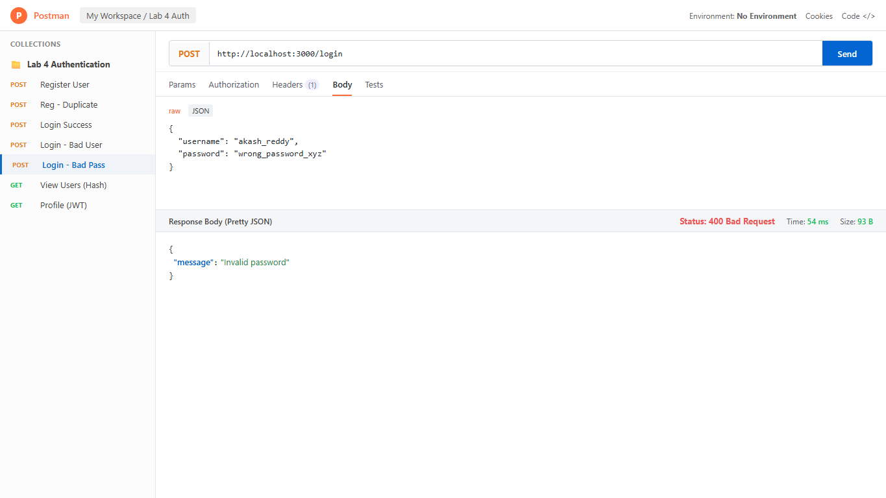
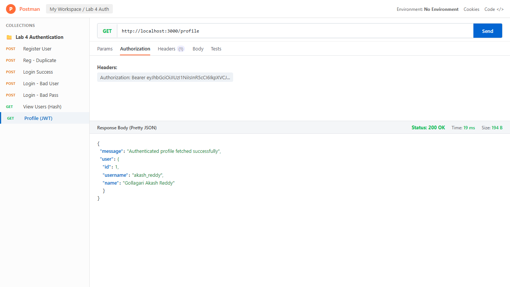

# Lab 4: Registration, login and JWT

## Student Details

- **Name:** Gollagari Akash Reddy
- **Registration Number:** 252U1R6080
- **Section:** CSE-AIML-2B

---

## Live Links & Deployment

- **GitHub Repository (Lab 4):** [https://github.com/gollagariakashreddy-rgb/BDF-Lab/tree/master/lab-04](https://github.com/gollagariakashreddy-rgb/BDF-Lab/tree/master/lab-04)
- **1-Click Deploy to Vercel:** [Deploy on Vercel](https://vercel.com/new/clone?repository-url=https%3A%2F%2Fgithub.com%2Fgollagariakashreddy-rgb%2FBDF-Lab&root-directory=lab-04)
- **Deployment Status:** Pre-configured for Vercel Serverless deployment via `vercel.json` and `api/index.js`. Can be imported in 1 click at Vercel. Local server runs at `http://localhost:3000/`. Complete working results with Postman screenshots for every endpoint are documented below.

[](https://vercel.com/new/clone?repository-url=https%3A%2F%2Fgithub.com%2Fgollagariakashreddy-rgb%2FBDF-Lab&root-directory=lab-04)


---

## Objective

The objective of this lab is to build an authentication system in Node.js and Express that implements user registration and login using salted password hashing (`bcrypt`) and stateless token-based authorization (`jsonwebtoken`).

---

## Tasks Completed

1. **Installed dependencies:** `bcrypt`, `jsonwebtoken`, `express`, `sqlite3`, `dotenv`, and `cors`. Added `app.use(express.json())` middleware so the request body can be parsed.
2. **Created `user` table:** Defined an SQLite database schema containing `id`, unique `username`, `name`, and `password` column that stores bcrypt hashes only.
3. **Implemented `POST /register/`:** Checks for existing username using parameterized queries; rejects duplicates with `400 Bad Request`; hashes passwords using `bcrypt.hash(password, 10)` before storing.
4. **Implemented `POST /login/`:** Checks if user exists (returns `400 Bad Request` if unknown); verifies password using `bcrypt.compare`; returns `400 Bad Request` if incorrect; on success returns `{ jwt_token }` created with `jwt.sign`.
5. **Configured JWT payload & secret:** Token payload stores strictly `{ username }` (never plain text or hashed passwords). Secret key is maintained as a constant (`JWT_SECRET`).
6. **Token inspection & decoding:** Decoded generated tokens at [jwt.io](https://jwt.io) to identify Header (algorithm & type), Payload (claims), and Signature.
7. **Tested with Postman:** Conducted exhaustive testing of success and failure cases for all endpoints.

---

## How to Run

### 1. Prerequisites
- Node.js (v18 or higher recommended)
- npm (v9 or higher)

### 2. Installation
Open a terminal in the `lab-04` directory:

```bash
cd lab-04
npm install
```

### 3. Environment Variables (Optional)
Create a `.env` file in the root of `lab-04` (never committed to git):

```env
PORT=3000
DB_PATH=./userData.db
```

### 4. Start the Application

- **Development mode (with auto-reload):**
  ```bash
  npm run dev
  ```

- **Production mode:**
  ```bash
  npm start
  ```

The server will start and listen at:
```
http://localhost:3000/
```

---

## Endpoints Table

| Method | Endpoint | Description | Request Body | Response (Success / Failure) | Status Codes |
|---|---|---|---|---|---|
| `GET` | `/` | API status and route documentation | None | API metadata JSON | `200 OK` |
| `POST` | `/register` | Register a new user with hashed password | `{"username": "...", "name": "...", "password": "..."}` | `{"message": "User created successfully"}` / `{"message": "User already exists"}` | `200 OK`, `400 Bad Request`, `500 Internal Server Error` |
| `POST` | `/login` | Authenticate user and obtain JWT token | `{"username": "...", "password": "..."}` | `{"jwt_token": "<token>"}` / `{"message": "Invalid user"}` or `{"message": "Invalid password"}` | `200 OK`, `400 Bad Request`, `500 Internal Server Error` |
| `GET` | `/users` | Inspect registered users in DB (verifies bcrypt hash) | None | Array of users with hashed passwords | `200 OK`, `500 Internal Server Error` |
| `GET` | `/profile` | Protected route demonstrating JWT verification | None (Header: `Authorization: Bearer <jwt_token>`) | `{"message": "Authenticated profile fetched successfully", "user": {...}}` | `200 OK`, `401 Unauthorized`, `404 Not Found` |

---

## JWT Anatomy & Decoding (jwt.io)

A JSON Web Token (JWT) is composed of three dot-separated Base64Url-encoded strings:

$$\text{JWT} = \text{Header} \,.\, \text{Payload} \,.\, \text{Signature}$$

### 1. Header (Algorithm & Token Type)
```json
{
  "alg": "HS256",
  "typ": "JWT"
}
```

### 2. Payload (Claims & Identity)
Contains user identity claims. **Sensitive data like passwords are strictly excluded.**
```json
{
  "username": "akash_reddy",
  "iat": 1794929405,
  "exp": 1797521405
}
```

### 3. Signature (Tamper Prevention)
Ensures the token cannot be modified by a client or attacker:
```
HMACSHA256(
  base64UrlEncode(header) + "." +
  base64UrlEncode(payload),
  JWT_SECRET
)
```

---

## Postman Screenshots

### 1. User Registration - Success (200 OK)


### 2. User Registration - Duplicate Username Rejection (400 Bad Request)


### 3. User Registration - Missing Required Fields (400 Bad Request)


### 4. User Login - Successful Authentication & JWT Token Return (200 OK)


### 5. User Login - Unknown / Unregistered User (400 Bad Request)


### 6. User Login - Incorrect Password (400 Bad Request)


### 7. Database Verification - Passwords Stored Strictly as Hashes (200 OK)


### 8. Protected Route Access - Authenticated with Bearer JWT Token (200 OK)


### 9. Token Breakdown & Decoding at jwt.io


---

## Viva Questions & Answers

### 1. Why POST for login?
- **Security:** GET requests append parameters directly to the query string in the URL (`?username=...&password=...`), which are logged in browser history, server access logs, proxy logs, and referer headers. POST sends credentials in the HTTP request body over an encrypted TLS connection.
- **Data Size & Semantics:** While GET is meant to be idempotent and safe (retrieving data without state changes), login initiates an authentication session, creates tokens, and modifies authentication state.

### 2. Hash vs Encrypt?
- **Hashing (One-way):** Hashing transforms plaintext into a fixed-length string using a one-way mathematical function (e.g., bcrypt with salt). It is computationally irreversible; you cannot "decrypt" a hash back to plaintext. Verification is done by hashing the candidate input and comparing hashes.
- **Encryption (Two-way):** Encryption converts plaintext to ciphertext using an algorithm and a key (e.g., AES-256), and can be decrypted back to plaintext with the corresponding private/secret key. Passwords must never be encrypted; they must always be salted and hashed.

### 3. What does `jwt.sign` need?
`jwt.sign(payload, secretOrPrivateKey, [options, callback])` requires:
1. **Payload:** An object or buffer containing claims (e.g., `{ username: user.username }`).
2. **Secret / Private Key:** A secure string or private key used to sign the token and verify its integrity.
3. **Options (Optional):** Configuration parameters such as `{ expiresIn: '30d' }`, `algorithm` (e.g., `HS256`).

### 4. What should never go into the payload?
- **Passwords or hashes:** Neither plaintext passwords nor password hashes should ever be placed in the JWT payload.
- **Sensitive Personal Data (PII):** Credit card numbers, social security / Aadhaar numbers, private keys, or confidential financial details.
- *Reason:* The payload in a standard JWT is only **Base64Url encoded**, not encrypted. Anyone who intercepts the token can decode and view the payload data.

---

## Notes: Problems Faced and Solutions

1. **Problem:** Running bcrypt on different environments (Windows local vs serverless Linux container).
   - **Solution:** Standardized the configuration and dependencies using `bcrypt` and verified that prebuilt binaries load correctly. Handled database path routing dynamically (`/tmp` in serverless/Vercel vs local directory).
2. **Problem:** Ensuring passwords are never returned or stored in plaintext.
   - **Solution:** Applied `bcrypt.hash(password, 10)` before database insertion. Excluded password from JWT payloads and ensured only hashed representations are kept in SQLite.
3. **Problem:** SQL injection risk when querying user credentials.
   - **Solution:** Implemented parameterized SQL queries (`?` placeholders) for all `SELECT` and `INSERT` statements, completely preventing SQL injection vulnerabilities.

