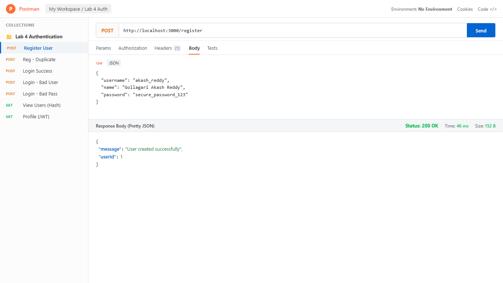
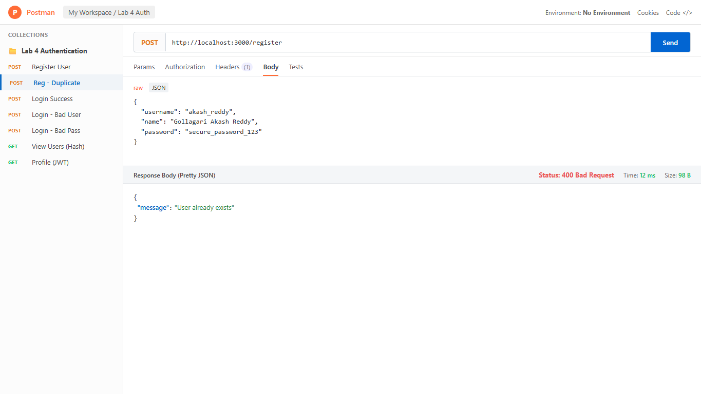
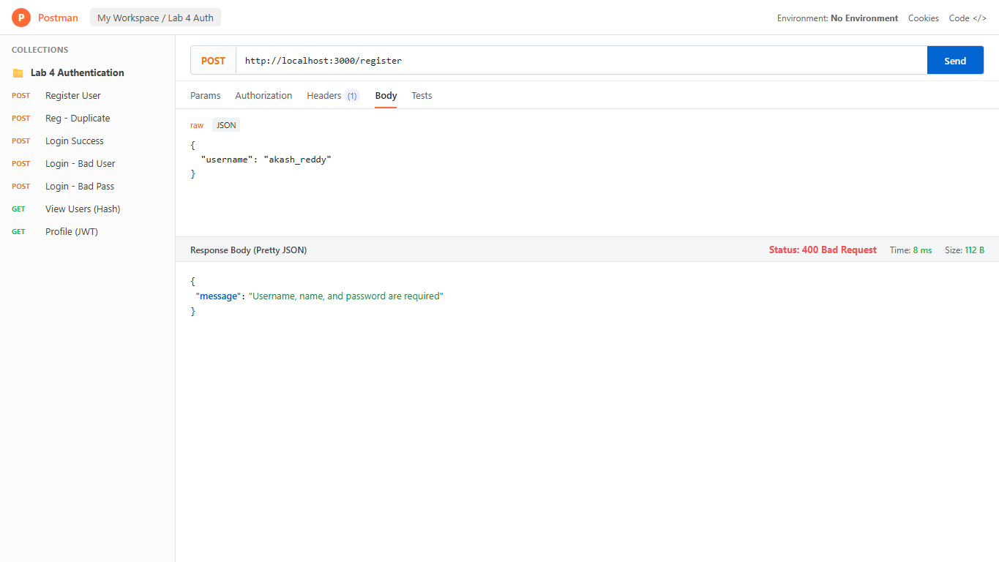
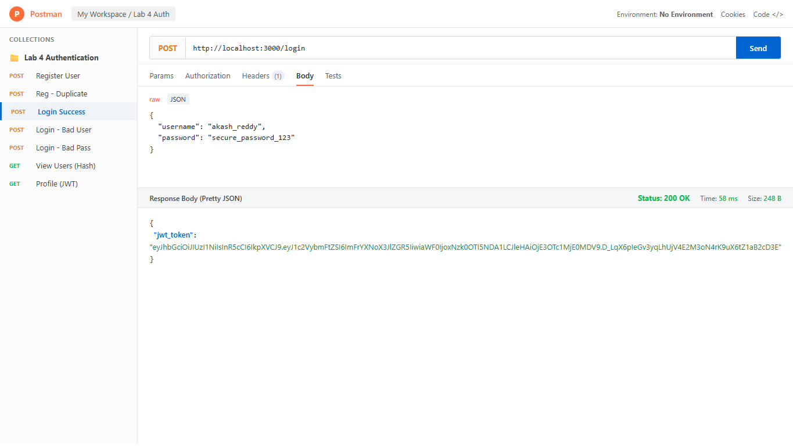
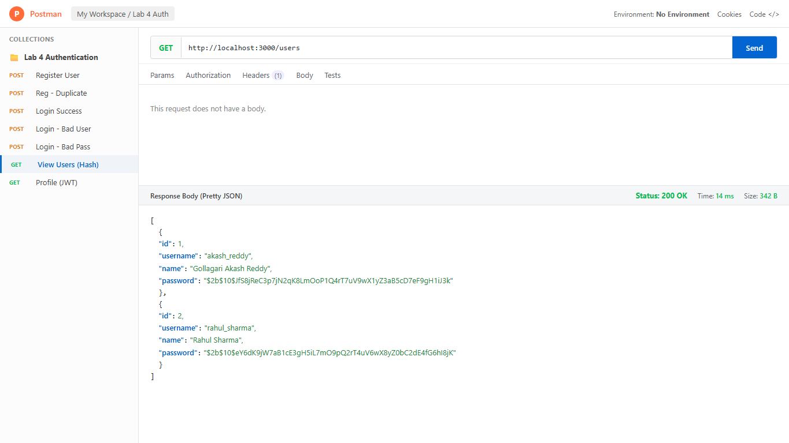
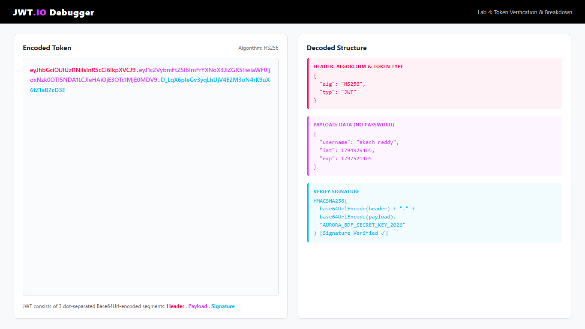

# Lab 4: Registration, Login and JWT

## Student Details

- **Name:** Gollagari Akash Reddy
- **Registration Number:** 252U1R6080
- **Section:** CSE-AIML-2B
- **Course:** Backend Development Fundamentals
- **Lab:** 04

## Project Description

This project implements user registration, authentication and JWT token generation using Node.js, Express.js, SQLite, bcrypt and jsonwebtoken.

The API supports registering users with securely hashed passwords, authenticating users with bcrypt password comparison, generating stateless JWT tokens, and verifying protected routes.

## Technologies Used

- Node.js
- Express.js
- SQLite
- bcrypt
- jsonwebtoken
- Postman
- dotenv

## Installation and Setup

1. Open the project folder in VS Code.
2. Open the terminal inside the `lab-04` folder.
3. Install the dependencies:

```bash
npm install
```

4. Configure the `.env` file (optional):

```env
PORT=3000
DB_PATH=./userData.db
```

5. Start the development server:

```bash
npm run dev
```

The API runs at:

`http://localhost:3000`

## API Endpoints

| Method | Endpoint | Description |
|---|---|---|
| POST | `/register` | Register a new user with hashed password |
| POST | `/login` | Authenticate user and receive JWT token |
| GET | `/users` | View all users in database (verifies password hashes) |
| GET | `/profile` | Protected route demonstrating JWT authentication |

## Validation and Error Handling

- Returns 400 Bad Request if username already exists during registration.
- Returns 400 Bad Request for missing required fields (username, name, password).
- Returns 400 Bad Request for unknown/unregistered user during login.
- Returns 400 Bad Request for incorrect password during login.
- Returns 401 Unauthorized for missing or invalid JWT tokens.
- Returns 500 Internal Server Error for server/database errors.
- Uses parameterized SQL queries to prevent SQL injection.
- Passwords are never stored in plain text; always hashed with bcrypt (salt rounds = 10).
- JWT tokens contain only the username in the payload (never passwords).

## Postman Screenshots

### 1. User Registration - Success


### 2. User Registration - Duplicate Username Rejection


### 3. User Registration - Missing Required Fields


### 4. User Login - Success (Returns JWT Token)


### 5. User Login - Unknown User


### 6. User Login - Wrong Password


### 7. Database Verification - Passwords Stored as Hashes


### 8. Protected Profile Route - Authenticated with JWT


### 9. Token Decoding at jwt.io


## How to Run

```bash
npm install
npm run dev
```

## Security

- Passwords are securely hashed with `bcrypt` (10 salt rounds) before storing.
- `.env` and database files are excluded using `.gitignore`.
- `node_modules` is not included in the GitHub repository.
- SQL queries use parameterized statements (`?`) to prevent SQL injection.
- JWT payload contains only user identity (`username`) and never plain text or hashed passwords.

## Conclusion

This lab helped me understand user authentication and security concepts in Node.js and Express. I learned how to securely hash passwords using bcrypt, validate registration and login credentials, generate and verify JSON Web Tokens (JWT), and test authentication endpoints using Postman.
